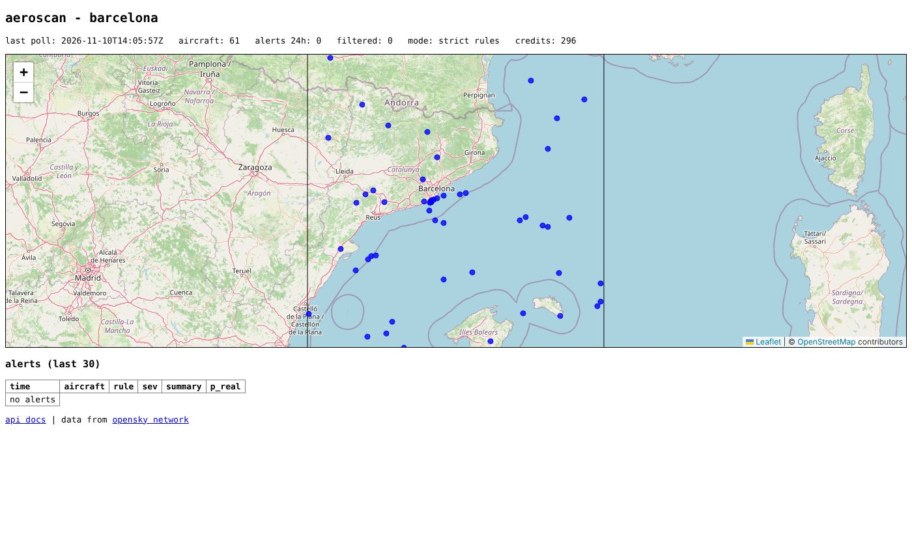

# Aero-Scan

Flight anomaly detection on open ADS-B data, centred on Barcelona–El Prat. **Loose deterministic rules flag; a learned triage model filters.** A fine-tuned small LLM was tested for the triage step and lost to gradient-boosted trees (see [Alert triage](#alert-triage-milestone-2)).

The detector watches each aircraft as a once-a-minute poller would see it (the budget of a free [OpenSky](https://opensky-network.org) account) and flags emergency transponder codes, rapid descents from altitude, turnbacks and holding. Every rule is a pure function of a short window of position reports, so it is unit-tested, deterministic, and identical live and in evaluation.

The monitored region is 39.3–43.3°N, 0–5°E: El Prat, Girona, Reus, Sabadell and Palma, 20 square degrees, which is one OpenSky credit per poll.



## Run it on your computer

Works on Windows, macOS and Linux. You need an internet connection and nothing else: [uv](https://docs.astral.sh/uv/) installs the right Python by itself.

**1. Install uv** (once), then open a new terminal window.

Windows, in PowerShell:
```powershell
powershell -ExecutionPolicy ByPass -c "irm https://astral.sh/uv/install.ps1 | iex"
```
macOS or Linux:
```bash
curl -LsSf https://astral.sh/uv/install.sh | sh
```

**2. Get the code.** With git:
```bash
git clone https://github.com/iosif75/aero-scan
cd aero-scan
```
Without git: on GitHub, click **Code → Download ZIP**, extract it, and open a terminal in the extracted folder.

**3. Start the monitor, the API and the map:**
```bash
uv run --extra api aeroscan serve
```
The first run takes a minute or two to download Python and the dependencies. Then open **http://127.0.0.1:8000** for the map, or **http://127.0.0.1:8000/docs** for the interactive API documentation. Stop it with **Ctrl+C**. Alerts are kept in `alerts.sqlite` in the same folder, so they survive restarts.

**4. Optional: OpenSky credentials, for all-day monitoring.** Without them it runs anonymously and pauses after about 6.7 hours a day. Create a free account at [opensky-network.org](https://opensky-network.org), add an API client on your Account page, download its `credentials.json`, and put it in the project folder. It is picked up automatically, and `.gitignore` keeps it out of git.

**5. Optional: the triage model.** Out of the box the monitor uses the strict rules. To run the better pipeline (loose rules + triage), build the model once; it needs the evaluation data, about 35 GB of downloads and an hour:
```bash
uv run --extra triage aeroscan fetch-data --bcn
uv run --extra triage aeroscan eval
uv run --extra triage aeroscan triage build
uv run --extra triage aeroscan triage fit
```
The next `serve` picks up `models/triage_gbm.pkl` and says "loose rules + triage" on the map.

## Results

Rules are evaluated with the **transponder code hidden**, to measure what they catch from movement alone, and with every flight replayed as 60-second polls. Thresholds were set on the dev split; the numbers below are the held-out **test split**.

### Emergencies (worldwide)

Barcelona alone saw too few emergencies to measure recall (11 of 832 in the reference set within 250 km), so detection is measured on the full worldwide set.

| Metric | Test split |
| --- | --- |
| Squawk-7700 flights | 397 |
| Detected from trajectory alone, all flights | 23% |
| Detected from trajectory alone, flights that diverted | 52% |
| Detected before the 7700 squawk appeared | 16 flights |
| Median detection time | 164 s after the squawk |
| Emergency-squawk rule, squawk visible | 100% |

Recall by reported problem (categories with ≥ 9 flights):

| Problem | Flights | Detected |
| --- | --- | --- |
| Cabin pressure | 9 | 7 (78%) |
| Smoke / burning smell / fire | 11 | 8 (73%) |
| Technical | 11 | 6 (55%) |
| Medical | 40 | 22 (55%) |
| Engine | 10 | 5 (50%) |
| Unclear | 104 | 30 (29%) |
| No public report | 186 | 7 (4%) |

**How to read this.** Many 7700 squawks leave no trace in the trajectory: the crew declares, carries on and lands as planned. Flights with no news or Aviation Herald report are mostly of that kind, hence 4%. Where the emergency changes the flight (a pressurisation descent, a return or a diversion), the rules catch about half or more. This is why the squawk rule stays in the live system: trajectory rules add early warning and context; they don't replace it.

### False alarms on ordinary traffic

| Dataset | Test split |
| --- | --- |
| **Barcelona region, 12 days of 2025** | 101 of 18,698 flights flagged (0.54%), 1 alert per ~83 flight-hours |
| of which descents from cruise | 7,569 flights, 58 `rapid_descent` alerts |
| Dublin approaches, 2019 | 30 of 8,756 flights (0.34%) |
| Normal part of the 7700 flights | 10 alerts in 289 flight-hours |

In operational terms, the Barcelona region sees about 3,100 flights a day, so **about 17 flights a day would be flagged in error** (18 before the turnback rule got airport context). That is the number to bring down: the [triage step](#alert-triage-milestone-2) behind looser rules cuts it to about 8 a day while catching more emergencies.

Emergency squawks seen in the 12 Barcelona days: 4 flights. Three held the code long enough to be reported by the squawk rule (two 7600 radio failures, one 7700) and are excluded from the false alarms; none showed a trajectory anomaly. The fourth was a 7700 lasting about a second, which the persistence filter correctly ignored.

Full output, including the dev split: [`eval/results/report.md`](eval/results/report.md).

### Known limitations

- **Turnbacks remain the main false alarm**: 58 of the 116 Barcelona test alerts and most Dublin ones. Airport context (below) removed most approach vectoring and slow climb-outs; what is left is mostly calibration, training and test flights flying racetracks, and arrivals that overfly an airport and turn back to land. The last look like a real return (a turn towards an airport while descending): an arrival test cut 4 more Barcelona flags but cost 2 test emergencies, so it was left out.
- **Steep normal descents**: at −3,750 ft/min the descent rule still flags about 0.3% of ordinary Barcelona flights.
- Ground truth for emergencies is "squawked 7700", so 7700 onset is the reference time. Some emergencies start earlier, which is why alerts up to 10 minutes before onset count as detections.
- The Barcelona false-alarm count is an upper bound: an alert on an ordinary day may occasionally be a real, unreported event.

## Alert triage (milestone 2)

The rules above are tuned to keep false alarms down, which costs detections. The alternative tested here: run **looser** rules and put a learned triage step behind them that sorts each alert into *real* or *routine*, plus a likely cause.

Training data comes from every alert of the loose rules (`aeroscan/triage/dataset.py`): 153 real and 2,952 routine alerts in dev, 159 and 2,995 in test. The model sees only the 15 minutes of polls before the alert, with no position, callsign, date or absolute heading, and every value rounded, so it can't learn which dataset an example came from instead of what the aircraft did.

Two triage models were compared, **trained on the same 903 dev examples** and scored on the full test split:

| Test split (3,154 alerts) | Gradient-boosted trees | Qwen2.5-1.5B-Instruct + LoRA |
| --- | --- | --- |
| ROC-AUC, real vs routine | **0.971** | 0.949 |
| Average precision | **0.756** | 0.514 |
| ROC-AUC, same source only | **0.877** | 0.855 |
| Routine alerts kept at 80% recall of real ones | **70** (Barcelona: 54) | 138 (Barcelona: 103) |
| Cause accuracy, known causes | 8% | 11.5% |

The LLM (`aeroscan/triage/train.py`, LoRA r=16, 3 epochs on an RTX 4070 Ti SUPER) is scored by the likelihood it gives each allowed answer, so both models are compared at identical operating points.

**Result: the fine-tuned LLM does not beat a conventional model here.** At the same detection rate it lets through about twice as many false alarms. With a few hundred examples of short numeric sequences, trees on hand-built features are the better tool. The gradient-boosted model trained on all 3,105 dev alerts does better still (ROC-AUC 0.975; 53 routine alerts kept at 80% recall).

The same-source row is the honest one: real alerts against the normal part of the very same 7700 flights, so it can't be inflated by recognising the dataset. Neither model can name the cause: movement alone, with about 80 labelled examples, does not tell an engine problem from a medical one.

Raw numbers: [`eval/results/triage_comparison.json`](eval/results/triage_comparison.json).

### The resulting pipeline

The gradient-boosted model, trained on all dev alerts, goes behind the loose rules (`aeroscan/triage/model.py`). Its threshold is chosen on out-of-fold dev predictions (5 folds, grouped by flight), as the strictest one that still detects as many dev emergencies as the strict rules. The test split is used once, for this table:

| Test split, per flight | Strict rules | Loose rules + triage |
| --- | --- | --- |
| Emergency flights detected (of 397) | 94 | **106** |
| Barcelona flights wrongly flagged (of 18,698) | 110 | **47** |
| Dublin approaches wrongly flagged (of 8,756) | 73 | **8** |
| False alarms on the normal part of the 7700 flights | 10 | 10 |

That is 13% more emergencies caught and less than half the Barcelona false alarms: about 8 a day across the whole region instead of about 18. The loose rules alone would catch 132 emergencies but flag 2,709 Barcelona flights; the triage step is what makes them usable.

The strict-rules column predates the airport context in the turnback rule (step 4 of the [evaluation method](#evaluation-method)); with it, the strict rules detect 93, flag 101 Barcelona and 30 Dublin flights, and still raise 10 alarms on the normal part of the 7700 flights. The loose rules behind triage run without the airport tests, so the model and its column are unchanged.

The live pipeline (`aeroscan/pipeline.py`) runs exactly this: replaying the test flights through it reproduces the table above. Raw numbers: [`eval/results/pipeline.json`](eval/results/pipeline.json). The trained model is not distributed; `aeroscan triage fit` builds it locally.

## Evaluation method

- **Data.**
  - Emergencies: [squawk7700](https://doi.org/10.5281/zenodo.3937483), 832 flights that squawked 7700 between Jan 2018 and Jan 2020, with problem labels, by X. Olive et al.
  - Barcelona traffic: 12 days of 2025 from the [adsb.lol](https://adsb.lol) open archive, one per month, alternating Wednesdays and Saturdays, cut to the monitored region (`aeroscan/eval/adsblol.py`). Coverage check on 16 July 2025: 1,085 El Prat movements reconstructed against Aena's July average of 1,086 a day, 99.6% of arrivals tracked to the runway, and 97.5% of 60 s polls receiving a fresh report.
  - Additional routine negatives: [arrival trajectories at Dublin, 2019](https://doi.org/10.4121/20411868.v1).
- **Polling simulation.** Each dense trajectory is resampled to what a 60 s poller on a fixed UTC grid would receive: the latest report, if it is no older than one interval, otherwise nothing (`aeroscan/eval/replay.py`).
- **Detection.** A MEDIUM-or-higher trajectory alert between 10 min before and 30 min after the first 7700 report.
- **False alarms.** MEDIUM-or-higher trajectory alerts on ordinary flights. Barcelona flights are split into flights at gaps of more than 20 minutes and must be at least 5 minutes long. Holding is informational and not counted.
- **Split.** Stable 50/50 by hash of flight ID. Every threshold was chosen on dev data only:
  1. Climb gate on turnbacks: before it, all 73 dev false alarms on the 7700 flights were turnbacks, mostly departures reversing while still climbing. The gate cut them to 16 for a loss of 8 of 93 detections.
  2. Departure-phase and speed gates on turnbacks: Barcelona and Palma departures take off eastbound over the sea and turn west, and on short legs reach cruise during the turn. Ignoring reversals by aircraft seen below 5,000 ft earlier in the window, and by aircraft slower than 220 kt (light aircraft), cut Barcelona dev flags from 51 to 32 for a loss of 6 of 106 detections.
  3. Descent threshold: −3,500 ft/min flagged 0.6% of ordinary Barcelona dev flights; −3,750 cut that to 0.2% for a loss of 8 of 100 detections.
  4. Airport context on turnbacks, from the nearest airport with scheduled service ([OurAirports](https://ourairports.com), bundled in `aeroscan/airports.csv`), within 40 NM. *Approach vectoring*: below 18,000 ft, the track was within 60° of the airport's bearing at the start of the turn and is now at least 120° off it (a downwind leg or a sequencing vector). *Slow climb-out*: the window's lowest report was at or below 10,000 ft within 40 NM of an airport, and the aircraft is still climbing at 500 ft/min or more. Together they cut dev flags from 87 to 85 in Barcelona and from 78 to 35 at Dublin, with no loss of the 92 dev detections. On the test split: Barcelona 110 to 101 flagged flights, Dublin 73 to 30, detections 94 to 93.

## Rules

| Rule | Fires when | Severity |
| --- | --- | --- |
| `squawk_emergency` | 7500 / 7600 / 7700 on 2 consecutive polls (filters accidental selections) | HIGH (7600: MEDIUM) |
| `rapid_descent` | ≤ −3,750 ft/min averaged over 2 consecutive minutes, starting ≥ 15,000 ft | HIGH |
| `turnback` | Track reversed ≥ 135° and held, ≥ 10,000 ft and ≥ 220 kt, not looping, not climbing > 1,000 ft/min, not in the departure phase, not approach vectoring or a slow climb-out near an airport | MEDIUM |
| `holding` | ≥ 330° of same-direction turn within 12 min | INFO |

Rates come from altitude differences between polls, not the reported instantaneous vertical rate. Implausible jumps (> 20,000 ft/min) are treated as corrupt reports, and the detector never reasons across coverage gaps.

## Reproduce the evaluation

```bash
uv sync --extra triage
uv run pytest                       # unit tests
uv run aeroscan fetch-data          # ~1 GB, checksummed, cached in ./data
uv run aeroscan fetch-data --bcn    # plus the Barcelona days: ~35 GB downloaded, ~1 h, ~200 MB kept
uv run aeroscan eval                # writes eval/results/
uv run aeroscan triage build        # labelled alerts -> data/triage
uv run aeroscan triage fit          # model -> models/triage_gbm.pkl, pipeline table -> eval/results
```

`aeroscan eval --skip-bcn` runs without the Barcelona data; `--limit 50` is a quick smoke test. Fine-tuning the LLM for the triage comparison needs a CUDA GPU: `uv run --extra train python -m aeroscan.triage.train`.

## Live monitoring and API

`aeroscan serve` runs the poller in the background and the API in front of it; `aeroscan live` runs the poller alone, and `aeroscan serve --no-live` serves an existing database. The pipeline uses the triage model if `models/triage_gbm.pkl` exists and falls back to the strict rules otherwise. Emergency squawks are never filtered.

| Endpoint | Returns |
| --- | --- |
| `GET /api/v1/alerts` | Alerts, newest first. Filters: `since`, `until` (no zone means UTC), `rule` and `severity` (repeat for several), `icao24`, `callsign` (prefix, any case), `min_p_real`. Paging: `limit` (≤ 500) and `cursor`, from the `Link: rel="next"` header; `X-Total-Count` gives the number of matches |
| `GET /api/v1/alerts/{id}` | One alert, with its evidence and triage score |
| `GET /api/v1/alerts/{id}/track` | The alert with the flight path around it (`before_min`, default 15, and `after_min`, default 10) |
| `GET /api/v1/aircraft` | Aircraft in the latest poll, flagged if alerted in the last `alerted_within_min` minutes |
| `GET /api/v1/aircraft/{icao24}` | One aircraft: its current state, the last `minutes` (default 60) of its track, and its recent alerts |
| `GET /api/v1/rules` | The rules the monitor runs: description, thresholds, alert counts |
| `GET /api/v1/polls` | Recent polls: aircraft seen, alerts raised and filtered, credits left |
| `GET /api/v1/stats` | Mode, counts, alerts in the last 24 h by rule, credits left |
| `GET /api/v1/stats/timeline` | Alerts by rule, filtered alerts and polls per UTC `hour` or `day` bucket, empty buckets included |
| `GET /api/v1/health` | `ok`, `stale` (monitor not polling) or `no_data` |
| `GET /api/v1/stream` | Server-sent events: `alert` as each alert is stored, `poll` after each poll. Reconnects resume from `Last-Event-ID`; `after_id=0` replays every alert first |
| `GET /api/v1/alerts.csv` | Alerts as CSV, with the same filters as `/alerts` (`limit` ≤ 100,000) |
| `GET /api/v1/geo/aircraft` | Aircraft in the latest poll as GeoJSON points |
| `GET /api/v1/geo/aircraft/{icao24}/track` | An aircraft's recent track as a GeoJSON line |
| `GET /api/v1/geo/alerts/{id}` | An alert as GeoJSON: the track around it, and the point where it was raised |
| `GET /docs` | Interactive OpenAPI documentation |

Times are UTC, and a time without a zone is read as UTC. Errors are JSON with a `detail` field. JSON responses carry an `ETag`, so a client that sends it back in `If-None-Match` gets `304 Not Modified` when nothing changed. The map follows the event stream rather than polling. From a script: `curl -N http://127.0.0.1:8000/api/v1/stream`.

The API is read-only: each request opens its own read-only SQLite connection, so it can't interfere with the poller (the database runs in WAL mode for concurrent reads). The poller keeps every position report for 24 hours (`--keep-tracks-hours`), so an alert can be shown with the path that raised it; at about 300 aircraft a minute that is roughly 430,000 rows, or under 100 MB. It listens on `127.0.0.1` by default. OpenSky's terms cover personal and research use, so check them before exposing the API publicly with `--host 0.0.0.0`.

- **Credentials.** Without them, requests are anonymous: 400 credits a day, counted per IP address, so a 60 s poll runs out after about 6.7 hours. With an OpenSky API client (4,000 credits a day) it runs all day. Put OpenSky's `credentials.json` in the working directory, or set `OPENSKY_CLIENT_ID` and `OPENSKY_CLIENT_SECRET`. Tokens are refreshed before their 30-minute expiry.
- **Cost.** The Barcelona box is 20 square degrees, which is 1 credit per poll: 1,440 a day at 60 s.
- **Behaviour matches the evaluation.** Polls land on a fixed 60 s grid, reports older than one interval are dropped, and units are converted to feet, knots and ft/min at the API boundary.
- **Storage.** SQLite, standard library only: `alerts`, `polls`, a `positions` snapshot of the latest poll, and `meta` (mode, region, interval).
- **Coverage caveat.** The evaluation measured coverage on adsb.lol data. OpenSky's receiver network around Catalonia may be thinner: a November afternoon test saw about 65 aircraft per poll in the box. Live detection rates can be lower than the offline ones where reports are missing.

## Roadmap

1. ~~Rules and offline evaluation~~
2. ~~Alert triage: learned real-vs-routine filter behind looser rules (gradient boosting beat a fine-tuned 1.5B LLM)~~
3. ~~Live ingestion from the OpenSky REST API, with the triage pipeline and SQLite alert storage~~
4. ~~REST API and map~~

## Data and attribution

Trajectory data: The OpenSky Network, https://opensky-network.org. M. Schäfer, M. Strohmeier, V. Lenders, I. Martinovic, M. Wilhelm, *Bringing up OpenSky: A large-scale ADS-B sensor network for research*, IPSN 2014.

squawk7700 dataset: X. Olive, A. Tanner, M. Strohmeier, M. Schäfer, M. Feridun, A. Tart, I. Martinovic, V. Lenders, *Reference datasets for in-flight emergency situations*, Zenodo, 2020, doi:10.5281/zenodo.3937483. Dublin arrivals: 4TU.ResearchData, doi:10.4121/20411868.v1 (CC BY-NC-SA 3.0).

Airports: [OurAirports](https://ourairports.com) (public domain), the large and medium airports with scheduled service; `scripts/update_airports.py` rebuilds the bundled list.

Map tiles: © OpenStreetMap contributors (ODbL), via the standard OSM tile server.

Barcelona traffic: © adsb.lol contributors, https://adsb.lol, made available under the [Open Database License 1.0](https://opendatacommons.org/licenses/odbl/1-0/).

The datasets are not redistributed here; `fetch-data` downloads them from their publishers. Published results are aggregated and contain no aircraft identifiers.

## Licence

Code: MIT. Data: see above; the OpenSky data terms restrict use to non-commercial research.
